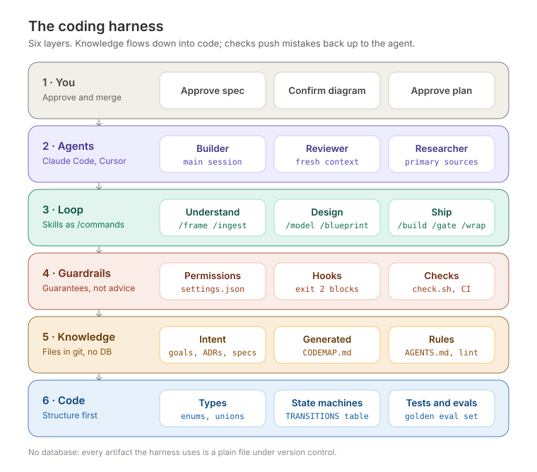

# coding-harness

An agentic engineering harness: a kit for Claude Code and Cursor, the deck that explains it, and the playbook behind it.

**Start here:** [Architecture overview](docs/architecture.md), covering the idea, the approach, the six layers, the loop, the guardrails and where knowledge lives.

## Contents

| Folder | Contents |
| --- | --- |
| `kit/` | Agentic kit v2 (66 files): AGENTS.md, CLAUDE.md, skills, subagents, hooks, lint rules, codemap generator, check script |
| `deck/` | Deck v2 source (29 slides): `deck.json`, `deck.css`, `slides/*.html` |
| `docs/` | [`architecture.md`](docs/architecture.md) (overview and diagrams) and [`playbook-v2.md`](docs/playbook-v2.md) (full playbook) |

## Links

- Playbook v2 (published doc): https://claude.ai/artifact/B9ytC4e58Un7PB75Q8cjzW
- Deck v2 (published artifact): https://claude.ai/artifact/RZUCEThETsn81QJXGFuHrS

## Principle

Structure over prose. Put each piece of project knowledge on the highest rung that can hold it: design, static checks, runtime checks, generated knowledge, prose, then human review.

## Getting started

Copy `kit/` into a repository and run `bash install.sh /path/to/repo`. It adds the new files and skips the ones you already have. Then run `python3 scripts/sync_agent_config.py` and `python3 scripts/codemap.py`.
