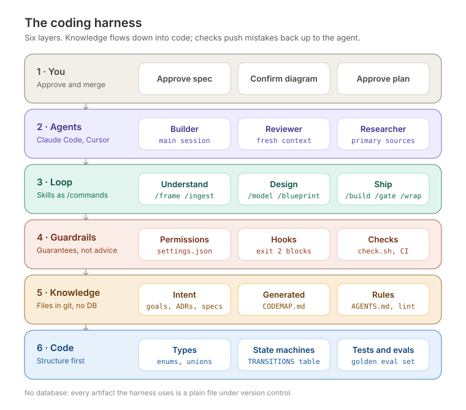
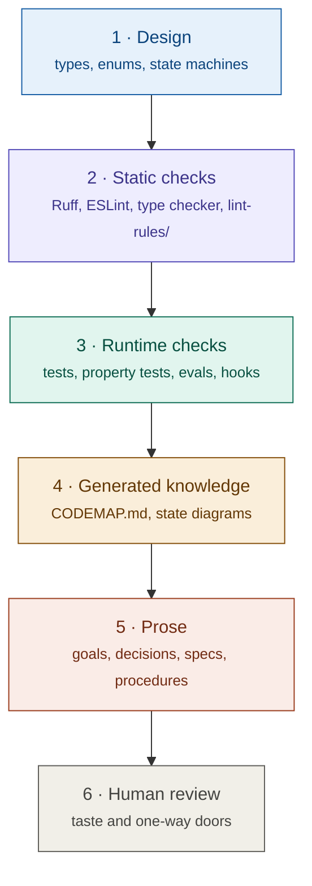
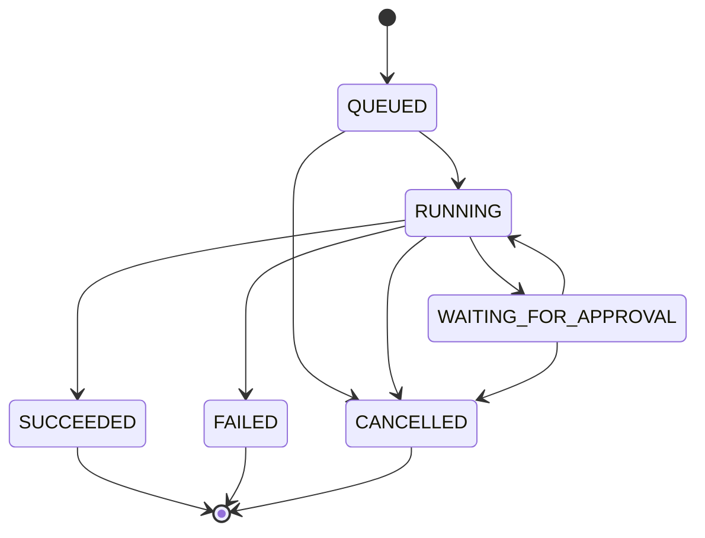
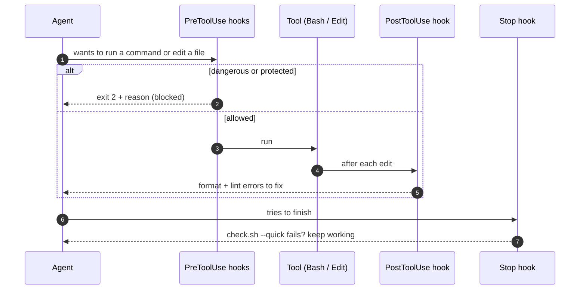

# The coding harness: architecture

> **One sentence:** an agent forgets everything between sessions, but the repository doesn't. The harness stores context, rules and memory in the repo so that Claude Code and Cursor pick them up on their own, and enforces the rules that matter in code instead of in prose.

<p align="center">
  
</p>

---

## Contents

1. [The idea](#1-the-idea)
2. [The approach: the knowledge ladder](#2-the-approach-the-knowledge-ladder)
3. [The six layers](#3-the-six-layers)
4. [The loop: how a change gets made](#4-the-loop-how-a-change-gets-made)
5. [Guardrails: how a mistake gets stopped](#5-guardrails-how-a-mistake-gets-stopped)
6. [Knowledge and storage (no database)](#6-knowledge-and-storage-no-database)
7. [Definition of done](#7-definition-of-done)
8. [Get started](#8-get-started)

---

## 1. The idea

| Problem | The harness's answer |
| --- | --- |
| The agent starts every session with no memory | Memory lives in versioned files the agent loads at session start |
| You end up repeating the same instructions | Instructions become skills (`/frame`, `/build` and so on) and path-scoped rules |
| A written rule is advice, and the agent can skip it | Rules that matter become types, lint rules, tests and hooks, which it can't skip |
| A hand-written description of the code goes stale | The code map is generated from the source (`scripts/codemap.py`) |
| The agent that built a change grades its own work | A separate reviewer subagent with a fresh context checks it |
| Agents copy whatever they find in the repo | Each change deletes the code, workarounds and warning comments it replaces |

---

## 2. The approach: the knowledge ladder

Put each piece of project knowledge on the **highest rung that can hold it**, and fix each repeated mistake at the **highest rung that can catch it**. The higher the rung, the harder it is for an agent to get around.



**The working rule for any correction:** can the code be redesigned so the mistake can't be written? If not, can a static check catch it? If not, can something that runs catch it? Only then write a sentence.

**The test for any line of markdown:** could a script have produced it from the code? If so, delete the line and write the script.

The ranking follows Lauren Tan's talk [*All Code Is Slop (Except Mine)*](https://ai.engineer/talks/O_zcc6Xl12g-all-code-is-slop-except-mine) (design, static analysis, verification, prose, review). The harness adds two things the talk doesn't cover: generated knowledge as its own rung, and evals beside tests.

---

## 3. The six layers

| # | Layer | What it holds | Where it lives in `kit/` |
| --- | --- | --- | --- |
| 1 | **You** | Approve the spec, confirm the state diagram, approve the plan, merge | Approval points in the skills; merges stay with you |
| 2 | **Agents** | A builder (the main session), a reviewer and a researcher | `.claude/agents/reviewer.md`, `.claude/agents/researcher.md` |
| 3 | **Loop** | Ten procedures you run as slash commands | `.claude/skills/*/SKILL.md` (mirrored to `.cursor/skills/`) |
| 4 | **Guardrails** | Permissions, five hooks, the check script, CI | `.claude/settings.json`, `.claude/hooks/*.py`, `scripts/check.sh` |
| 5 | **Knowledge** | Intent, generated maps, rules | `AGENTS.md`, `CLAUDE.md`, `.claude/rules/`, `docs/`, `lint-rules/` |
| 6 | **Code** | Types, state machines, tests and evals | Your source tree; reference pattern in `.claude/skills/model/reference/` |

Knowledge flows **down** into the code. Feedback flows **up**: a failing check or a blocked hook returns its message to the agent, which fixes the problem before you see it.

### What runs where

| Concern | Claude Code | Cursor |
| --- | --- | --- |
| Shared project instructions | `AGENTS.md`, imported by `CLAUDE.md` via `@AGENTS.md` | `AGENTS.md` |
| Path-scoped rules | `.claude/rules/*.md` | `.cursor/rules/*.mdc` (generated by `scripts/sync_agent_config.py`) |
| Skills and subagents | `.claude/skills/`, `.claude/agents/` | `.cursor/skills/`, `.cursor/agents/` (copied by the same script) |
| Hooks | `.claude/settings.json` | Not wired by the kit; `check.sh` and CI still apply |

---

## 4. The loop: how a change gets made

```mermaid
flowchart LR
    F["/frame<br/><small>spec + acceptance criteria</small>"]:::plan --> I["/ingest<br/><small>research unknowns</small>"]:::plan
    I --> M["/model<br/><small>types + state diagram</small>"]:::design
    M --> P["/blueprint<br/><small>step-by-step plan</small>"]:::design
    P --> B["/build<br/><small>one step, one check, one commit</small>"]:::ship
    B --> G["/gate<br/><small>independent review</small>"]:::ship
    G --> W["/wrap<br/><small>update memory</small>"]:::ship
    classDef plan fill:#E1F5EE,stroke:#0F6E56,color:#085041
    classDef design fill:#EEEDFE,stroke:#534AB7,color:#3C3489
    classDef ship fill:#FAECE7,stroke:#993C1D,color:#712B13
```



| Step | Command | Output | Your part |
| --- | --- | --- | --- |
| Frame | `/frame <idea>` | `docs/specs/<slug>.md` | **Approve the spec** |
| Ingest | `/ingest <topic>` | `docs/knowledge/<topic>.md` | Read it |
| Model | `/model <spec>` | Types, transition table, tests, generated diagram | **Confirm the diagram** |
| Blueprint | `/blueprint <spec>` | `docs/plans/<slug>.md` | **Approve the plan** |
| Build | `/build` | Code and commits | Nothing, unless it stops |
| Gate | `/gate` | Reviewer findings and evidence per criterion | Read the report |
| Wrap | `/wrap` | Handoff note, proposed ADRs and lessons | Confirm what gets recorded |

**Supporting skills**
- `/decide` scores two to four options against weighted criteria (5, 5, 4, 4, 3, 3, 2, 2; maximum 140) and writes an ADR, which can't be edited once accepted.
- `/learn` takes a repeated mistake up the ladder.
- `/radar` scans for new tools and sorts each into adopt, trial, assess or hold.

**Rules of the loop**
- **Two strikes.** After two failed attempts at a step, the agent stops and reports.
- **The plan is the contract.** A wrong step is fixed in the plan first.
- **Never fake green.** No skipped tests, loosened evals or lint suppressions.
- **Leave it worth copying.** Delete what you replace in the same commit.
- **Skip `/model`** only when the change has no lifecycle and adds no module.

### The state-machine pattern `/model` produces

One enum, one transition table, one function. Nothing else may assign the state.

```python
class RunState(str, Enum):
    QUEUED = "queued"
    RUNNING = "running"
    WAITING_FOR_APPROVAL = "waiting_for_approval"
    SUCCEEDED = "succeeded"
    FAILED = "failed"
    CANCELLED = "cancelled"

TRANSITIONS: dict[RunState, frozenset[RunState]] = {
    RunState.QUEUED: frozenset({RunState.RUNNING, RunState.CANCELLED}),
    RunState.RUNNING: frozenset({RunState.WAITING_FOR_APPROVAL, RunState.SUCCEEDED,
                                 RunState.FAILED, RunState.CANCELLED}),
    RunState.WAITING_FOR_APPROVAL: frozenset({RunState.RUNNING, RunState.CANCELLED}),
    RunState.SUCCEEDED: frozenset(),
    RunState.FAILED: frozenset(),
    RunState.CANCELLED: frozenset(),
}

def transition(current: RunState, target: RunState) -> RunState:
    if target not in TRANSITIONS[current]:
        raise IllegalTransition(current, target)
    return target
```

Because the table is data, `scripts/codemap.py` draws it, and you review the drawing before any behaviour exists:



The same table feeds four tests: every state has a row, every state is reachable, a terminal state can be reached from every state, and in a property-based walk (Hypothesis) every random move is either legal or rejected.

Use a state machine where something has three or more states and the order of moves matters, such as an agent run, a chat turn, a job or an approval. For plain request-and-response code, a typed function is simpler and just as strong.

---

## 5. Guardrails: how a mistake gets stopped

A hook blocks an action by exiting with code `2`, and the agent reads the hook's message as feedback. Every guard in the kit works this way, so a correction reaches the agent at the moment it makes the mistake.



| Layer | Mechanism | Catches | When |
| --- | --- | --- | --- |
| 0 · Design | Types, state machines, import boundaries | Illegal states, illegal moves, wrong-way imports | While writing |
| 1 · Permissions | `allow` / `deny` in `.claude/settings.json` | Reading `.env` and `secrets/` | Before a tool runs |
| 2 · Command guard | `guard_bash.py` | Push to main, force-push, `--no-verify`, `git reset --hard`, `rm -rf` on the repo, `pip install`, `npm install`, `curl \| sh` | Before each shell command |
| 3 · File guard | `protect_files.py` | Edits to `.env`, lock files, `.git`, the generated code map; asks before changing accepted ADRs, `evals/golden/` or the harness | Before each edit |
| 4 · Edit loop | `format_lint.py` | Formatting and lint errors | After each edit |
| 5 · Standards | `.claude/rules/*.md` | Judgment calls for the file in hand | While writing |
| 6 · Stop gate | `stop_gate.py` | Finishing while lint or types fail | When the agent tries to stop |
| 7 · Review | `/gate` with the `reviewer` subagent | Unmet criteria, diagram that contradicts the spec, leftover code, weak tests | Before a pull request |
| 8 · CI | `scripts/check.sh` | All of the above, plus a stale code map and project lint rules | Every pull request |

`session_context.py` runs at session start and prints the goals, the active plan, recent decisions and recent lessons into the agent's context, so a new session picks up where the last one stopped.

---

## 6. Knowledge and storage (no database)

**The harness uses no database, vector store or external service.** Every piece of knowledge is a plain file in git, so it can be reviewed, diffed and reverted, and both tools can read it.

| File | Answers | Written by | Rung |
| --- | --- | --- | --- |
| `docs/CODEMAP.md` | What's in the code, and how do its states move? | `scripts/codemap.py` (a hook blocks hand edits) | 4 · Generated |
| `AGENTS.md` | What is this project, which commands run it, what's non-negotiable? | You, kept short (86 lines) | 5 · Prose |
| `.claude/rules/*.md` | Standards that need judgment, scoped by path | You and `/learn` | 5 · Prose |
| `lint-rules/*.yml` | Project-specific mistakes, each with a message that says what to do instead | `/learn` | 2 · Static |
| `docs/GOALS.md` | What are we building, what aren't we, which quality wins? | You, reviewed monthly | 5 · Prose |
| `docs/specs/`, `docs/plans/` | What this change must do, and in which steps | `/frame`, `/blueprint` | 5 · Prose |
| `docs/decisions/NNNN-*.md` | Why is it built this way? | `/decide`, after you choose | 5 · Prose |
| `docs/LESSONS.md` | What went wrong before? | `/learn`, `/wrap` | 5 · Prose |
| `docs/knowledge/*.md` | What do we know about topic X, as of which date? | `/ingest` | 5 · Prose |
| `docs/RADAR.md` | Which tools to adopt, trial, assess or hold | `/radar` | 5 · Prose |
| `evals/golden/` | What does a good answer or ranking look like? | You (protected) | 3 · Runtime |

A database only enters with **the product you build**, for example a talent-search index. When it does, its schema belongs on rung 1 as types, its queries are covered by tests and evals, and its layout appears in the generated code map. It never becomes part of the harness's own memory.

---

## 7. Definition of done

A change is done when all of these hold:

- [ ] `scripts/check.sh` passes, and its output is shown
- [ ] Each acceptance criterion has evidence: a test, an eval score, command output or a screenshot
- [ ] The plan's boxes are ticked
- [ ] Replaced code, workarounds and warning comments are deleted
- [ ] The agent lists what it could not verify

### When agents may merge their own work (optional)

| Condition | Evidence |
| --- | --- |
| The top three rungs carry the load | Recurring review comments have become types, lint rules or tests |
| Behaviour is proven, not claimed | Every change ships with tests, evals or screenshots that CI checks |
| Escapes are measured | Reverts and bugs fixed forward stay flat as volume rises |
| The blast radius is small | Staged rollout and one-step rollback |

Until all four hold, a person merges.

---

## 8. Get started

```bash
# 1. Install the kit into your repo (it adds new files and skips existing ones)
bash kit/install.sh /path/to/your/repo
cd /path/to/your/repo

# 2. Mirror rules, skills and agents for Cursor, and generate the code map
python3 scripts/sync_agent_config.py
python3 scripts/codemap.py

# 3. Install the project linter and run it
uv tool install ast-grep-cli
ast-grep scan

# 4. Run the full gate
bash scripts/check.sh
```

Then pick the one thing in your product that has a lifecycle and run `/model` on it.

### What's verified and what isn't

- **Verified in the kit:** the four state-machine tests pass, the code-map generator produces the diagram above, the sample lint rule flags `os.getenv` outside `core/config.py`, and `check.sh` fails on that violation as intended.
- **Not configured by the kit:** `import-linter` contracts, and the TypeScript versions of the patterns. `.claude/rules/structure.md` describes them, but you set them up per project.
- **Not run in a live session:** the hook behaviour inside Claude Code. The scripts follow the [hooks reference](https://code.claude.com/docs/en/hooks.md).

---

**Related:** [Playbook v2](playbook-v2.md) · [Deck v2 source](../deck/) · [Published deck](https://claude.ai/artifact/RZUCEThETsn81QJXGFuHrS) · [Published playbook](https://claude.ai/artifact/B9ytC4e58Un7PB75Q8cjzW)
