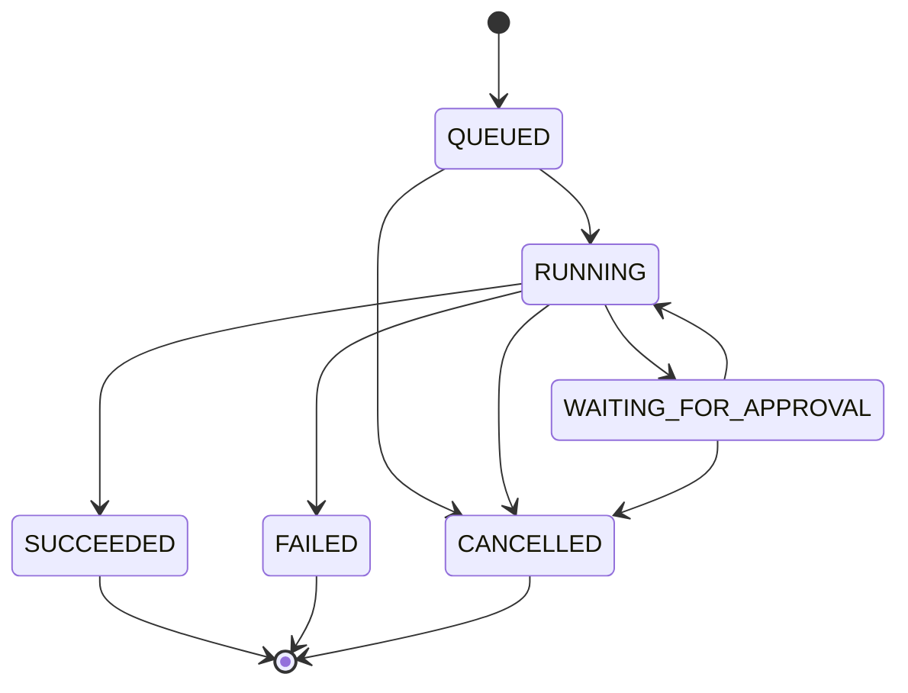

# Agentic Engineering Playbook v2 — Structure Over Prose

Nov 16, 2026 · @Ram

## What changed in v2

v2 keeps v1's loop and memory and changes where knowledge lives: in the code's own structure first, in checks second, and in markdown only for what code cannot say. The originals are untouched: [playbook v1](https://claude.ai/artifact/4R1BaBkvmmrvUC6cC4io6Q) and [deck v1](https://claude.ai/artifact/GZj1NQmGYpUkT9PJBueR6H).

| Area | v1 | v2 | Why |
| --- | --- | --- | --- |
| Knowledge of the codebase | Layout lines in `AGENTS.md` | `docs/CODEMAP.md`, generated from the source, with a state diagram per machine | A derived map cannot go stale; a written one always does |
| Design before code | None; the plan went straight to steps | `/model`: types, states and boundaries first, and you confirm the diagram | A wrong arrow costs a minute before the build and a rewrite after |
| Fixing a repeated mistake | `/learn` chose a hook, a rule or a lesson | `/learn` climbs a ladder: redesign, static check, runtime check, prose | Each rung down is easier for an agent to skip |
| Project lint | Ruff and ESLint defaults | Plus `lint-rules/`: project rules whose messages teach the fix | Guidance arrives at the moment of the mistake |
| Repo hygiene | Not addressed | Delete what you replace; no workaround or warning comment left behind | Agents copy whatever is in the repo |
| Evidence of done | `check.sh` passes | Plus a test, eval score or screenshot per acceptance criterion | A passing lint says nothing about behaviour |
| Kit size | 54 files | 66 files | Download: `agentic-kit-v2.zip` |

## The video's argument

Lauren Tan's talk, [All Code Is Slop (Except Mine)](https://ai.engineer/talks/O_zcc6Xl12g-all-code-is-slop-except-mine), says that when agents write faster than people can read, quality must come from the codebase and its checks, because human review is the costliest layer and should carry the least.

She ranks where a decision should live, most capacity first: codebase design, then static analysis, then verification, then prose rules and skills, then human review. The practice that follows is to move every recurring correction as far up that list as it will go.

| What her team does | Why |
| --- | --- |
| Bans a pattern in code instead of warning about it in text | An agent cannot skip a compiler or a lint rule |
| Puts guidance in lint messages | The agent meets it at the moment it breaks the rule |
| Deletes workarounds and deprecated code | Agents copy what is in the repo, so every bad example spreads |
| Has agents run the app and capture screenshots or video | Evidence of behaviour, not a claim of it |
| Draws the state machine a change implies (a statechart skill) | A reviewer can see whether the agent understood the intent |

The numbers are her own and unaudited: about 3,000 of her pull requests and about 11,000 from the team in one month, with roughly 0.5% reverted. That rate counts reverts only, so a bug fixed by a later pull request is not in it. She presents agents merging their own work as the result of this groundwork, not the starting point.

An earlier [write-up of her September post](https://redreamality.com/blog/lauren-tan-poteto-trust-before-parallel/) adds the framing: throughput comes from trust, and running more agents before the repo is worth copying only multiplies bad output.

## Critique

The video is right about the order and thin on intent; v1 was right about intent and thin on structure. Combined they are stronger than either, and both still miss two things a search-and-chat product needs: a design step before the build, and evals.

| Question | The video | Playbook v1 | Verdict for v2 |
| --- | --- | --- | --- |
| Where should knowledge live? | In code and checks; prose is the smallest layer | Mostly markdown, plus hooks | The video is right. v1 under-invested in the code itself |
| Is a `.md` about the codebase useful? | Not relied on; the repo is the input | Hand-written layout lines | Your instinct holds. Describe nothing by hand that can be generated |
| State machines | Drawn after the fact so a reviewer can check intent | Absent | Go further than both: make the machine the code, then derive the diagram and the tests from it |
| Goals, specs, reasons | Barely covered | `GOALS.md`, ADRs, specs | v1 is right. A lint rule can say what is banned, never what to build or why |
| Comments | Bans nearly all of them | No position | Half right. Ban warnings and narration. Keep docstrings on agent tools, MCP tools and routes: there the model or client reads them, so they are interface |
| Quality of AI features | UI evidence, tests, early formal methods | One line in a rule file | Neither is enough. Search and chat need a golden set and scored evals |
| Starting from nothing | Rules grow out of observed mistakes | Templates up front | Seed the structure with `/model`, then let mistakes add rules |
| Scale | About 227 contributors and a large token budget | One person | Take the order, not the volume. Self-merging agents are her destination, not your start |
| Measure | Share of pull requests reverted | Corrections you repeat | Use both, plus eval score. Her rate misses bugs fixed forward, as the talk's own summary notes |

**Limits of the video.** The numbers are self-reported. The setting is one desktop client, so proof by screenshot and video fits it better than it fits an API or a ranking model. The formal-methods work is described as early. And it assumes someone already decided what to build.

**Limits of v1.** It asked nicely too often. Its first answer to a mistake was a hook or a rule, not a redesign. It had no step for designing types and states, said nothing about cleaning up bad examples, and let a prose description stand in for knowledge of the code.

**State machines, with a caution.** They earn their place where something has three or more states and the order of moves matters: an agent run, a chat turn, a job, an approval, a candidate pipeline. They are overhead for plain request-and-response code or a linear pipeline, where a typed function is the simpler, stronger structure.

## The v2 principle: the strongest form that holds it

Every piece of knowledge about the project goes on the highest rung that can hold it, and each mistake is fixed at the highest rung that can catch it.

*Knowledge ladder · 6 rungs, widest holds most (diagram in the deck)*

The wider the rung, the more of the project's knowledge it should carry. This extends the video's pyramid in three ways:

- **Generated knowledge is its own rung.** The code map, state diagrams and API or MCP schemas are derived from the source by a script. They give an agent the orientation a prose description promised, without going stale.
- **Prose is split by purpose.** Description of the code leaves markdown entirely. Intent stays: goals, decisions with their reasons, specs, and procedures. Code cannot hold those.
- **Evals sit beside tests.** For anything a model produces (a ranking, a chat answer) a scored eval against a golden set is the runtime check. Lint and types cannot judge it.

The working rule for any correction: ask whether the code can be redesigned so the mistake cannot be written; if not, whether a static check can catch it; if not, whether something that runs can; and only then write a sentence.

## Structure in the code

Less slop comes from code that cannot express the mistake, so v2 adds seven mechanisms on the top three rungs and a generator for the fourth.

| Mechanism | Prevents | Python | TypeScript |
| --- | --- | --- | --- |
| Enums and literal unions | A status held as a bare string | `Enum`, `Literal` | String-literal unions |
| Discriminated unions | Optional fields standing in for states | Pydantic models with a literal tag | Tagged unions |
| Exhaustive handling | A new state nobody handles | `match` with `assert_never`, strict type checking | `switch` with a `never` default |
| State machine | Illegal moves between states | `Enum` + `TRANSITIONS` + one `transition()` | Same shape, or a statechart library |
| Import contracts | Core logic depending on a web or agent framework | `import-linter` | ESLint `no-restricted-imports` |
| Project lint rules | A project-specific mistake repeating | ast-grep rules in `lint-rules/` | ast-grep or ESLint |
| Property-based tests | Paths nobody thought to write down | Hypothesis | fast-check |
| Generated map | A stale description of the code | `scripts/codemap.py` | Export names only |

The state-machine pattern is three parts, and nothing else may assign the state:

```python
class RunState(str, Enum):
    QUEUED = "queued"
    RUNNING = "running"
    WAITING_FOR_APPROVAL = "waiting_for_approval"
    SUCCEEDED = "succeeded"
    FAILED = "failed"
    CANCELLED = "cancelled"

TRANSITIONS: dict[RunState, frozenset[RunState]] = {
    RunState.QUEUED: frozenset({RunState.RUNNING, RunState.CANCELLED}),
    RunState.RUNNING: frozenset({RunState.WAITING_FOR_APPROVAL, RunState.SUCCEEDED,
                                 RunState.FAILED, RunState.CANCELLED}),
    RunState.WAITING_FOR_APPROVAL: frozenset({RunState.RUNNING, RunState.CANCELLED}),
    RunState.SUCCEEDED: frozenset(),
    RunState.FAILED: frozenset(),
    RunState.CANCELLED: frozenset(),
}

def transition(current: RunState, target: RunState) -> RunState:
    if target not in TRANSITIONS[current]:
        raise IllegalTransition(current, target)
    return target
```

Because the table is data, the code map draws it. This is what `codemap.py` produced from the table above:



You review that picture in `/model`, before any behaviour exists. The same table feeds four tests: every state has a row, every state is reachable, a terminal state is reachable from everywhere, and a property-based walk of random moves is either legal or rejected.

What was run here: the four reference tests pass; the map and diagram above were generated on a sample project; the sample lint rule flagged `os.getenv` in a route file and stayed quiet in `core/config.py`; `check.sh` failed on that violation as intended. Not run: `import-linter` contracts and the TypeScript mechanisms, which the rule file names but the kit does not configure for you.

## Where each thing lives

Markdown now holds intent and procedure only; everything else has a stronger home.

| You want to | Put it in | Rung |
| --- | --- | --- |
| Make a mistake impossible | Types, `Enum`, `TRANSITIONS`, function signatures, module layout | 1 |
| Catch it in seconds | Ruff, ESLint, the type checker, `lint-rules/`, import contracts | 2 |
| Catch it before the agent finishes | Tests, property tests, evals, the hooks in `.claude/hooks/`, CI | 3 |
| Orient an agent in the code | `docs/CODEMAP.md`, generated; a hook blocks hand edits | 4 |
| State the project, commands and non-negotiables | `AGENTS.md` (86 lines), imported by `CLAUDE.md` | 5 |
| Give standards that need judgment | Path-scoped rules, now including `structure.md` | 5 |
| Package a procedure | Skills, run as `/name` | 5 |
| Record what for and why | `docs/GOALS.md`, `docs/decisions/`, `docs/specs/` | 5 |
| Keep research or review out of the main context | Subagents | Isolation |

A useful test for any line of markdown: could a script have produced it from the code? If yes, delete the line and write the script.

## The work loop

The loop gains one step, `/model`, and you now approve three things: the spec, the state diagram and the plan.

| Step | Command | What the agent does | Output | You |
| --- | --- | --- | --- | --- |
| 1. Frame | `/frame <idea>` | Reads goals and past decisions, asks up to five questions once, writes checkable acceptance criteria | `docs/specs/<slug>.md` | Approve the spec |
| 2. Ingest | `/ingest <topic>` | Researches unknowns from primary sources in a separate context | `docs/knowledge/<topic>.md` | Read the answer |
| 3. Model (new) | `/model <spec>` | Reads the code map, writes types, the transition table, its tests and the import boundary; no behaviour | Structure that compiles, and a diagram | Confirm the diagram |
| 4. Blueprint | `/blueprint <spec>` | Plans from the code map and the model; routes costly choices to `/decide` | `docs/plans/<slug>.md` | Approve the plan |
| 5. Build | `/build` | One step, one check, one commit; deletes what it replaces; changes state only through `transition()` | Code and commits | Nothing, unless it stops |
| 6. Gate | `/gate` | A reviewer that never saw the build checks the diff, the diagram against the spec, and leftover residue; requires evidence per criterion | Findings and evidence | Read the report |
| 7. Wrap | `/wrap` | Updates the handoff note, proposes ADRs and lessons, teaches back what was new | Updated memory | Confirm what is recorded |

The rules of the loop, with one addition:

- **Trivial changes skip to Build.** If the diff cannot be described in one sentence, it is not trivial.
- **Two strikes.** After two failed attempts at a step, the agent stops and reports.
- **The plan is the contract.** A wrong step is fixed in the plan first. Scope changes wait for you.
- **Never fake green.** No skipped tests, loosened evals or lint suppressions.
- **Leave it worth copying (new).** Replaced code, workarounds and warning comments are removed in the same commit, because the next agent will imitate whatever remains.

Skip `/model` only when the change has no lifecycle and adds no module: a typed function needs no machine.

## Boundaries

v1 had eight layers that guard what the agent does; v2 puts a design layer above them that guards what the code can say.

| Layer | Mechanism | Catches | When |
| --- | --- | --- | --- |
| 0. Design (new) | Types, state machines, import boundaries | Illegal states, illegal moves, wrong-way dependencies | While writing; the code will not type-check |
| 1. Permissions | `allow` / `deny` in `.claude/settings.json` | Reading `.env` and `secrets/` | Before a tool runs |
| 2. Command guard | `guard_bash.py` | Push to main, force-push, `--no-verify`, `rm -rf` on the repo, `pip install`, `npm install` | Before each shell command |
| 3. File guard | `protect_files.py` | Edits to `.env`, lock files, the generated code map (new); asks before touching accepted ADRs, the golden eval set (new) or the hooks | Before each edit |
| 4. Edit loop | `format_lint.py` | Formatting and lint errors, returned to the agent | After each edit |
| 5. Standards | Path-scoped rules | Style and judgment calls for the file in hand | While writing |
| 6. Stop gate | `stop_gate.py` | Finishing while lint or types fail | When the agent tries to stop |
| 7. Review | `/gate` with the `reviewer` subagent | Unmet criteria, diagram that contradicts the spec, residue, weak tests | Before a pull request |
| 8. CI | `scripts/check.sh` | Everything above, plus a stale code map and project lint rules (new) | On every pull request |

A hook blocks by exiting with code 2, and its message is what the agent reads. The same idea now applies to lint: each rule in `lint-rules/` carries a note that says what to do instead, so the correction reaches the agent at the moment it errs.

**Definition of done:** `scripts/check.sh` passes with its output shown; each acceptance criterion has evidence (a test, an eval score, command output, or a screenshot of the running app); plan boxes are ticked; and the agent lists what it could not verify.

## Memory, learning and autonomy

These carry over from v1 with three changes: the code map joins the memory files, `/learn` climbs the ladder, and self-merging becomes a sixth rung you may never need.

**Memory.** Five files, one of them generated:

| File | Answers | Written by |
| --- | --- | --- |
| `docs/CODEMAP.md` (new) | What is in the code, and how do its states move? | `scripts/codemap.py` |
| `docs/GOALS.md` | What are we building, what are we not, which quality wins? | You, reviewed monthly |
| `docs/decisions/NNNN-*.md` | Why is it built this way? | `/decide`, after you choose |
| `docs/LESSONS.md` | What went wrong before? | `/learn` and `/wrap` |
| `docs/knowledge/*.md` | What do we know about topic X, as of which date? | `/ingest` |

**Decisions.** `/decide` is unchanged: two to four options including doing nothing, eight weighted criteria (5, 5, 4, 4, 3, 3, 2, 2; maximum 140), a veto on a score of 1 for fit or safety, and an immutable ADR once you choose.

**Learning.** `/radar` still scans weekly and sorts findings into adopt, trial, assess or hold. `/learn` now asks, in order: redesign, static check, runtime check, prose. It also cleans up existing instances of the mistake in the same change, since a rule loses to the examples around it.

**Autonomy.** The five rungs stand: paired, gated, parallel, background, scheduled. v1 said a person always merges. The video shows a team where agents merge most of their own work, and presents that as the result of the groundwork. v2 treats it as an optional sixth rung with entry conditions:

| To let agents merge their own work | Evidence you need first |
| --- | --- |
| The top three rungs carry the load | Recurring review comments have become types, lint rules or tests |
| Behaviour is proven, not claimed | Each change ships with tests, evals or screenshots that CI checks |
| Escapes are measured | You track reverts and bugs fixed forward, and both are flat as volume rises |
| The blast radius is small | Staged rollout and one-step rollback; one-way doors still need you |

Until all four hold, a person merges.

## Upgrading from v1

Install v2 on a fresh repo as before, or upgrade a v1 repo in an afternoon; the order below puts the highest-value change first.

- [ ] Unzip `agentic-kit-v2.zip` and run `bash install.sh /path/to/repo`; it adds the new files and skips the ones you have
- [ ] Copy over the changed files after reading the diff: `AGENTS.md`, the `learn`, `blueprint`, `build` and `gate` skills, `reviewer.md`, `protect_files.py`, `scripts/check.sh`
- [ ] Run `python3 scripts/sync_agent_config.py` and `python3 scripts/codemap.py`, then commit `docs/CODEMAP.md`
- [ ] Delete every prose description of the code from `AGENTS.md` and your rule files
- [ ] Install ast-grep (`uv tool install ast-grep-cli`) and run `ast-grep scan`
- [ ] Turn on strict type checking, and add `hypothesis` and `import-linter` as dev dependencies
- [ ] Pick the one thing in your product with a lifecycle and run `/model` on it
- [ ] Take your three most repeated corrections through the new `/learn`; aim for at least one redesign and one lint rule
- [ ] Search for workarounds, dead code and warning comments, and delete them before the next agent copies them

For the talent-search product, the first three machines to model are the search request (received, retrieving, ranking, done, failed), the chat turn, and the agent run with its approval state. The golden eval set stays the definition of quality for ranking and chat answers; structure makes the code correct, evals make the product good.

## Sources

Read on 16 November 2026. The talk's figures are the speaker's own and have not been independently checked.

- [All Code Is Slop (Except Mine), Lauren Tan, AI Engineer (talk page and summary)](https://ai.engineer/talks/O_zcc6Xl12g-all-code-is-slop-except-mine)
- [Trust First, Then Parallel: What Lauren Tan's Talk Actually Argues (third-party write-up of her September 2026 post)](https://redreamality.com/blog/lauren-tan-poteto-trust-before-parallel/)
- [Claude Code: memory, CLAUDE.md, rules and AGENTS.md](https://code.claude.com/docs/en/memory)
- [Claude Code: hooks reference](https://code.claude.com/docs/en/hooks.md)
- [Cursor: rules and AGENTS.md](https://cursor.com/docs/rules.md)

I read the talk through its published page, not by watching the video, so details that appear only on screen may be missing. The knowledge ladder, the `/model` step, the generated code map and the merge conditions are this playbook's own design.
